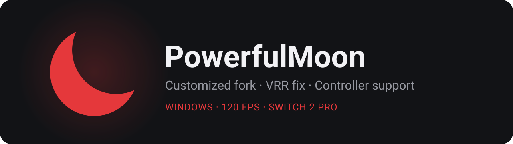
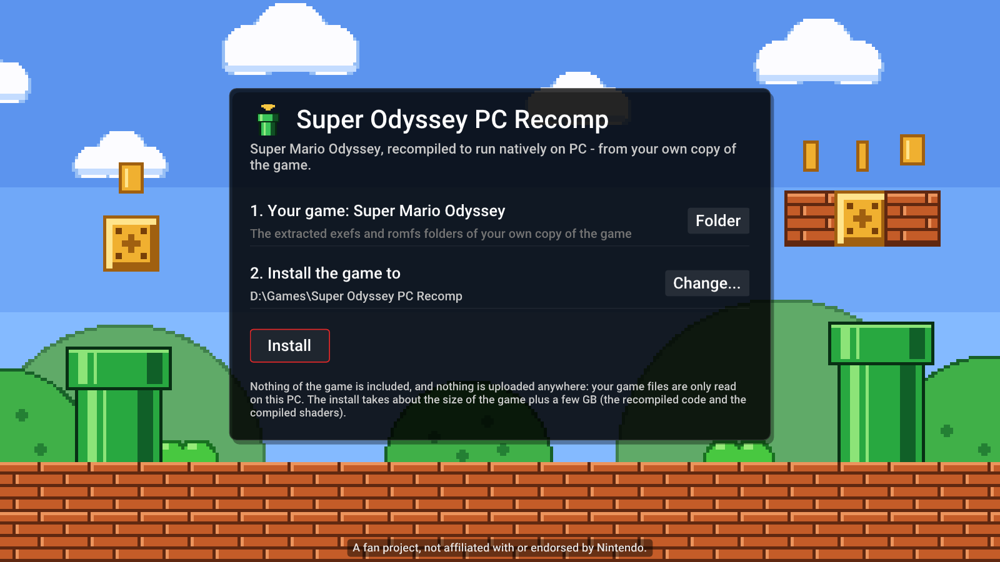

  <a href="https://github.com/yngvifreyr1810/PowerfulMoon/releases/latest"><b>Download PowerfulMoon</b></a> ·
  <a href="#install">Get started</a> ·
  <a href="docs/STATUS.md">Status</a> ·
  <a href="#known-issues">Known issues</a> ·
  <a href="docs/ENGINEERING-NOTES.md">Engineering notes</a> ·
  <a href="https://github.com/yngvifreyr1810/PowerfulMoon/issues">PowerfulMoon issues</a>

PowerfulMoon follows [Super Odyssey PC Recomp](https://github.com/Simon3Sarkis/super-odyssey-pc-recomp).
See the [upstream review and release process](docs/powerfulmoon-releases.md) for how this fork takes updates.

**Super Odyssey PC Recomp** is a native PC port of *Super Mario Odyssey* (Nintendo Switch, versions 1.0.0 and 1.4.1)
for Windows, Linux and the Steam Deck, made by static recompilation and built on your PC from your own copy of the
game.

  
  
  
  

Screenshots taken in Super Odyssey PC Recomp at 3840 x 2160 (click for full size). The game is © Nintendo; you need your own copy to run it.

> [!IMPORTANT]
> **You must bring your own game.** This project contains **no game files, no game code and no assets** -
> only the installer and the source code. To play, you need the **`exefs` and `romfs` folders of your own copy of
> Super Mario Odyssey**, already extracted. Instructions for getting game files are
> not provided, and requests for game files will be closed.

> [!NOTE]
> **This is an AI-made project.** The code of this port was written by AI: almost all of it by **Claude**
> (Anthropic's AI model, through Claude Code), with some fixes and features from OpenAI's **Codex**. The maintainer
> doesn't write the code; they direct the work, test every build on Windows and a Steam Deck, and run the releases.
> See [Who made this](#who-made-this).

> [!WARNING]
> **This is an early preview.** The whole game can be played, but there are known issues (see
> [Known issues](#known-issues)) and things that still need fixing. If something breaks at a high frame rate, set
> **Performance > Frame rate** to 60 for that moment, and please report what you find.

## Features

- **The whole game from your own copy**, versions 1.0.0 and 1.4.1 - no emulator runs while you play
- **Frame rates from 60 to 240 FPS**, every frame really drawn, with **Match display** picking the smoothest rate for
  your screen
- **Resolutions up to 4K and beyond** (up to 4x the Switch's), and any screen shape: 16:9, 16:10, 21:9, 32:9, 4:3 or
  Fill, with the HUD at the edges on ultrawide
- **Upscaling** with NVIDIA DLSS / DLAA, AMD FSR 1 / 2 / 3.1 / 4 and Intel XeSS, the HUD drawn at full resolution over
  the upscaled picture, plus **frame generation** (AMD FSR, NVIDIA DLSS beta) and NVIDIA Reflex
- **No shader stutter**: every shader is prepared before you play, and again by itself after a driver update
- **Sharper than the Switch when you want it**: FXAA or SMAA, 2x / 4x shadow maps, texture detail, 16x anisotropic
  filtering, smooth colour gradients - and **the Switch's own look by default**
- **Any controller**, with button icons that match it (Xbox, PlayStation, Switch), a Joy-Con pair, motion controls
  and vibration; **keyboard and mouse** with a real mouse camera, and the mouse in the game's own menus
- **A start screen and settings menu made for controller, mouse and keyboard**, where every option says what it does
  and what is recommended - in English, Korean and Brazilian Portuguese
- **Steam Deck and PC handhelds**: 1280 x 800 at 60 FPS in Gaming Mode
- **Built-in updates**, RomFS mods, 5.1 surround, a performance overlay, Discord activity (off by default)
- **Crash reports you can read**: what happened, where, and a signature to match the same crash between players

New Donk City at 3840 x 2160 and 120 FPS with the graphics card at 38% (RTX 4090; the overlay in the corner is MSI Afterburner's).

  
  

The start screen and the settings menu (0.4.1): Play first, categories in a sidebar, every option explained.

## Status

| Area | Share | Progress |
|---|---|---|
| Core game | 45% |  |
| Platforms and input | 15% |  |
| Performance | 15% |  |
| Graphics options | 12% |  |
| Player features | 13% |  |

Every part, what it means, what holds it back and how the average is calculated: [Status](docs/STATUS.md).

**Current focus:** no crashes, steady memory and no frame drops, then the open [issues](../../issues) - the plan is in
[docs/stability-plan.md](docs/stability-plan.md). Releases only go out after the release build itself has been
played on Windows and checked on Linux.

## What it is

The game's ARM64 code is translated to C ahead of time and compiled into a regular program on your PC - no emulator
runs while you play. The parts of the Switch the game talks to (kernel, system services, the NVN graphics API, audio)
are reimplemented on the PC, with Vulkan for graphics.

Windows 10 / 11 (x64). **Linux and Steam Deck: experimental** - an AppImage, see [docs/linux.md](docs/linux.md).

## Install

1. Download the latest `...-windows.zip` from [Releases](../../releases) and extract it anywhere
   you own (for example `D:\Games`, **not** Program Files). Start `SuperOdysseyRecomp.exe`.
   It isn't code-signed: if SmartScreen says "Windows protected your PC", choose *More info*, then *Run anyway*.
2. The installer asks for:
   1. **Your game**: the folder that holds the extracted **`exefs`** and **`romfs`** folders of your own Super Mario
      Odyssey - version **1.0.0**, or **1.4.1** with the update already applied (its full `romfs`, not only the
      update's). `exefs` holds `main`, `main.npdm` and `sdk`; `romfs` holds folders such as `StageData` and
      `SystemData`.
   2. **Install the game to**: where the game data, saves and shaders go (about 12 GB).
3. Press **Install**. It copies the game data, recompiles the game code for your PC (a few minutes) and compiles every
   shader (several minutes, once).
4. Press **Play**. Every start then shows the start screen: **Play** (already selected: A, Enter or Start),
   **Settings** and **Exit**. Untick *Show this screen at every start* to go straight to the game.

## Updating

New versions are published on this page. The game checks for them at start (in the background - only GitHub is
contacted and nothing about you or your game is sent; you can switch this off) and shows a note when one is out.
Open the menu (**F1**) > **Updates** > **Download and install**, then **Restart now**. Your game files, saves,
settings and mods stay; if the new version needs it, the game code is rebuilt and the shaders re-prepared once, by
themselves.

You can also download the new zip from [Releases](../../releases) and extract it over your current folder.

## Known issues

This is a preview. Known problems and things not done yet:

- **Being worked on** (from the [issues](../../issues)):
  - The game freezes on Radeon RX 7800 XT under Linux (#21).
  - The Steam Deck's own gyro isn't read yet (#68); a no-sound report on the Deck (#43).
  - High committed memory on PCs with 16 GB of RAM (#75, #61).
- **Frame rates above 60** are less tested than 60, on both game versions: some objects or effects can move unevenly.
  Painting transitions play at 60 FPS on purpose.
- **Version 1.4.1** is newer in this port than 1.0.0 and less tested.
- **A short stutter can still happen** the first time a rare effect is drawn whose pipeline state nobody has recorded
  yet. It's prepared then and kept for next time.
- **Online features** of the game (anything that needs Nintendo's servers) don't work.
- **Code mods** (exefs patches, IPS / pchtxt, online mods) can't be used: the game code is rebuilt from the original.
  RomFS mods work.
- **Windows Defender** may flag the new, unsigned program by its machine-learning guess (a `!ml` detection) - it
  reads game files, builds code and starts helper programs, which looks unusual. Please report it as a false positive at
  https://www.microsoft.com/wdsi/filesubmission and open an issue with the detection name.
- **Linux and Steam Deck are experimental**: less tested than Windows ([docs/linux.md](docs/linux.md)). A Vulkan 1.3
  GPU is required everywhere.
- Graphics glitches can show up in places nobody has tested yet - please report them with a screenshot.

## Reporting a problem

Open an [issue](../../issues) with:

- what happened and where in the game (a screenshot helps),
- your game version (1.0.0 or 1.4.1), Windows version, CPU and GPU,
- the log, `SuperOdysseyRecomp.log`, from the install folder (it doesn't contain any game files),
- after a crash, the **crash report**: the error box has a **Copy crash report** button. The report starts with a
  summary (what happened, where, the stage, your settings) that usually tells us what to fix.

For a graphics glitch, pressing **F9** where it happens saves the frame's details into the log, which helps a lot.

## What you need

- Windows 10 / 11 (x64), a 64-bit CPU - AVX2 (Intel Haswell / AMD Zen or newer) recommended; older CPUs without AVX2
  (Intel Sandy / Ivy Bridge and earlier) are supported but slower - a GPU with Vulkan 1.3 and an up-to-date driver
- 8 GB RAM (16 GB recommended), about 12 GB free disk space
- The extracted `exefs` and `romfs` folders of your own Super Mario Odyssey (1.0.0, or 1.4.1 with the update applied)

## Settings

Open the menu with **F1** or **Esc** (controller: Home / Guide button, or Back + Start). The categories are in a
sidebar on the left: move onto one to see it, press A / Enter / Right (or click) to go into it, B / Esc to come back,
and L / R (Q / E) to switch from anywhere. The bar at the bottom shows what your buttons do, and the text on the right
explains the selected option and says what is recommended.

- **Display**: windowed, borderless or exclusive fullscreen, display resolution, VSync, aspect ratio, console mode
- **Graphics**: internal resolution, anti-aliasing, upscaling and frame generation, texture filtering and detail,
  shadow quality, smooth gradients
- **Performance**: early frame hand-off, multithreaded rendering, frame rate (60 to 240 FPS or Match display), the FPS
  counter and performance overlay, Discord activity, shader preparation
- **Audio**: volume, stereo or 5.1, reverb, movie audio, mute in background
- **Controls**: motion controls, vibration, stick deadzone and speed, mouse camera, mouse in menus, button prompts,
  key and button rebinding
- **Language**, **Mods** (RomFS mods on and off), **Updates**

## Controls

| Switch | Keyboard | Controller |
|---|---|---|
| Left stick | W A S D | left stick |
| Right stick (camera) | mouse, or Num 8 / 4 / 5 / 6 | right stick |
| A / B / X / Y | K / J / L / I | by position (east = A, south = B) |
| L / R, ZL / ZR | Q / E, 1 / 3 | shoulder buttons / triggers |
| + / - | Enter / Backspace | Start / Back |
| Stick clicks | F / Num 0 | stick clicks |
| D-pad | arrow keys | d-pad |

Fullscreen: F11 or Alt+Enter. Everything can be rebound in the menu.

The mouse turns the camera while you play: the pointer stays in the window until you open the menu (Esc) or switch to
another window. Sensitivity, invert up / down, or switching it off: menu > Controls > Mouse.

The game's button icons follow what you play with: after a key press or mouse movement they show the keys you bound
(WASD for moving, a mouse for the camera), after a controller press that controller's own buttons: Xbox (A B X Y,
LB / RB / LT / RT), PlayStation (cross circle square triangle, L1 / R1 / L2 / R2) or the Switch's. With two controllers
connected, the one you press a button on takes over. Menu > Controls > *Button prompts* can fix them to one style.

Motion controls (shake to throw Cappy at a target, and the game's other motion moves) use the controller's gyro and
accelerometer: PlayStation and Switch Pro controllers. Menu > Controls > *Motion controls* turns them off.

## Files

The program folder holds the program; the install folder (the same one unless you chose another) holds:

- `extracted\` - your game data as the installer wrote it and the game code built from it (`odyssey_game.dll`)
- `save\` - your saves, `cache\` - compiled shaders, `settings.ini` - settings, `SuperOdysseyRecomp.log` - the log
- `mods\` - optional RomFS mods, each in its own folder (`mods\<Mod name>\romfs\...`; the Atmosphere layout works too)

Never share `extracted\` or anything built from it: it's Nintendo's game.

### Brazilian Portuguese fan translation

The separately obtained **JumpManClub Brasil v1.1** RomFS mod can be selected
with **Controls > System language > Português (Brasil)**. It uses the game's
US English slot, and the menu reports whether the complete known package is
enabled without conflicting files. See [installation, limitations and credits](docs/PT-BR.md).
If the translation is missing, selecting the language offers to download and install
the official package. Confirm the installation, then restart when prompted.
No translation files are bundled; no download starts without confirmation.

## Building from source

Needs MSYS2 (UCRT64: clang, SDL3, FFmpeg, shaderc, Python) - `tools\setup_windows.ps1` installs them. See
[docs/BUILD-windows.md](docs/BUILD-windows.md).

1. Put your extracted game folders into `extracted\` (`extracted\exefs\`, `extracted\romfs\`), or start the built
   program and let its installer copy them there.
2. From an MSYS2 UCRT64 shell in this folder:

       make gen        # recompile the game from extracted/exefs into generated/
       make -j16       # build/SuperOdysseyRecomp.exe and the game code, build/odyssey_game.dll
       make dlls       # copy SDL3 / FFmpeg / shaderc DLLs next to the exe

3. A release: `make deps-windows` (an LGPL-only FFmpeg), `make gen-helper`, `tools/fetch_zig.sh`, then `make dist`.
   The zip holds no game code.

## How it works

- `tools/` - the recompiler (Python): `gen.py` lifts every function of the game's NSO modules to C (`lifter.py`);
  `odyssey_patches.py` holds the few game-specific patches for 1.0.0 and 1.4.1.
- `runtime/` - the program: module loader, a small Horizon kernel, IPC services, HLE of SDK functions, NVN on Vulkan
  with a Maxwell shader translator (`runtime/nvn`), movies with FFmpeg, the menu (Dear ImGui), the installer
  (`runtime/ui/setup.mm`), the game code build (`runtime/gamebuild.c`) and the updater (`runtime/updater.c`).
- Debugging tools are environment variables (`ODYSSEY_*`), documented where they're read.

## Who made this

**The code of this port was written by AI, not by the maintainer.** Nearly all of it was written by **Claude**
(Anthropic's AI model, working through Claude Code): the recompiler's patches, the runtime, the Vulkan renderer, the
installer, the Linux version and the release pipeline. OpenAI's **Codex** contributed a number of fixes and features.

The maintainer, [Simon3Sarkis](https://github.com/Simon3Sarkis), hasn't written the code. What they do:

- decide what gets worked on and in what order, and what's good enough to ship
- test every build on their own PC and a Steam Deck, on both game versions, before anything is released
- play through the game to find bugs, reproduce what players report, and compare the port with the Switch version
- run the project: the issues, the replies to players, the releases

Bug reports are read and worked on the same way: the maintainer tests, and Claude writes the fix.

## Credits

- **Power Moon Recomp** by its contributors - the Super Mario Odyssey port this project continues (MIT license); its
  original repository is no longer online.
- **[LAS Recomp](https://github.com/peiikai/LASRecomp)** by Peiikai and its contributors - the static recompiler,
  runtime and renderer Power Moon Recomp is built on, and the frame interpolation (MIT license).
- **[PrimeRecomp](https://github.com/gminustwo/primerecomp)** by its contributors - the GPU ASTC texture decoder
  (`runtime/nvn/vulkan/astc_gpu.c`) and its GPU scratch memory (MIT license).
- **[MacNativeGames](https://github.com/ly05010419/MacNativeGames)** - the game package reading code `runtime/nxpkg.c`
  is ported from (MIT license, `tools/vendor/macnativegames`), and
  **[TotK PC Recomp](https://github.com/valentderah/totk-pc-recomp)**'s hactool build script (`tools/build_hactool.py`,
  MIT) used for checking
- [OdysseyDecomp](https://github.com/MonsterDruide1/OdysseyDecomp) - names and structure of the game's code, used for
  reading and debugging (no code from it is in this repository)
- [Switchbrew](https://switchbrew.org) and [envytools](https://github.com/envytools/envytools) - documentation of the
  Switch's system interfaces and the Maxwell GPU
- An MIT-licensed open-source project's audio renderer and shader instruction decoders (`third_party/ryujinx/LICENSE.txt`)
- Libraries: [SDL 3](https://libsdl.org) (zlib), [FFmpeg](https://ffmpeg.org) (LGPL, linked dynamically),
  [Dear ImGui](https://github.com/ocornut/imgui) (MIT), [Vulkan Memory Allocator](https://github.com/GPUOpen-LibrariesAndSDKs/VulkanMemoryAllocator) (MIT),
  [shaderc](https://github.com/google/shaderc) (Apache 2.0), [SMAA](https://github.com/iryoku/smaa) (MIT),
  [AMD FSR 1](https://github.com/GPUOpen-Effects/FidelityFX-FSR) (MIT), the [Roboto](https://github.com/googlefonts/roboto)
  font (Apache 2.0), NVIDIA DLSS (NVIDIA RTX SDK license)
- In the release, to build the game code on your PC: [Zig](https://ziglang.org) (MIT) with LLVM / Clang / LLD (Apache
  2.0 with LLVM exception) and MinGW-w64 headers; the generator runs on [Python](https://www.python.org) (PSF license)
  with [Capstone](https://www.capstone-engine.org) (BSD), [Unicorn](https://www.unicorn-engine.org) (GPL 2.0) and
  [LZ4](https://github.com/python-lz4/python-lz4) (BSD). The release carries every licence in `licenses/`.

The installer's pixel-art background and the icon are original artwork made for this project.

## Contributing

Bug reports, logs and pull requests are welcome - see [Reporting a problem](#reporting-a-problem) for what a report
needs. Every pull request is checked line by line for anything harmful, then built and played on **Windows and a
Steam Deck** before it is merged; nothing from a contributor ships untested. Never include or link game files.

**Contributors**

- **[galaxyhf](https://github.com/galaxyhf) (Caio Silva)** - Brazilian Portuguese: the localization support, the
  Language tab and the fan translation's installer (#49, #56, #58); **Discord activity** and the fix for game
  folders with accents in their path on Windows (#78); **the mouse in the game's own menus** - click, wheel and
  pointer (#86).
- **zzzarathustra-dev** - shaders precompiled before the first start and the first Steam Deck defaults (0.2.1).
- **Codex** (OpenAI) - fixes and features across the runtime (see [Who made this](#who-made-this)).
- Everyone who reported a bug with logs, crash reports, screenshots and saves: most fixes started there - the
  painting crash was found from two players' reports (#72, #85), the frame generation crash from one log (#77).

## For other recomp projects

What went wrong here and what fixed it is written up so others don't have to find it twice:

- **[Engineering notes](docs/ENGINEERING-NOTES.md)**: how we test (scripted runs, old and new behaviour back to
  back, release builds tested before they're published), the crashes we hit above 60 FPS, with frame generation and
  on quit, the memory growth, the sound crackling, the ways our own tests misled us - and how the shader stutter was
  solved and the Steam Deck reached 60 FPS.
- **[Performance techniques](docs/OPTIMIZATIONS.md)**: frame pacing, not waiting for the GPU, shader preparation,
  native high frame rates, the HUD after upscaling, any screen shape - each with how it was measured.

The code they point to is MIT licensed: take what helps.

## Legal

This is a fan project. It is not affiliated with, endorsed by or sponsored by Nintendo. *Super Mario Odyssey* and
*Nintendo Switch* are trademarks of Nintendo. No game files, game code, assets or fonts are included in this
repository or its releases, and nothing built from your game files (`extracted/`, `generated/`, `odyssey_game.dll`)
may be shared. You must provide the extracted files of your own legally obtained copy of the game.

## License

The code of this repository is under the [MIT License](LICENSE) (it keeps LAS Recomp's and Power Moon Recomp's
copyright notices). Third-party components keep their own licenses (above, and in `third_party/`). The license covers
this project's code only - it grants nothing for Nintendo's game.
